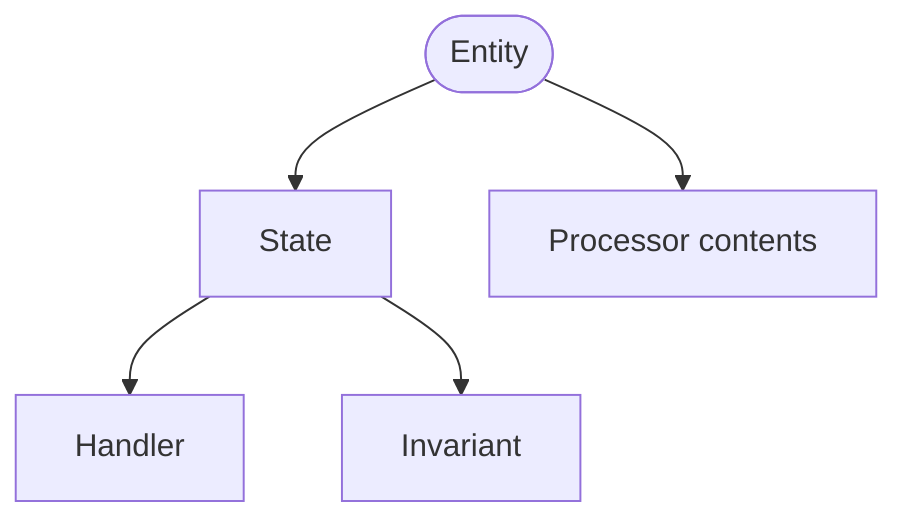

<!-- riddl-prelude
event OrderEvent is { id is String }
event OrderPlaced is { id is String }
command PlaceOrder is { id is String }
record OrderData is { id is String }
-->

An entity in RIDDL is the same as it is in DDD which defines it this way:

!!! hint 
    `Entity Definition`

    : _An object primarily defined by its identity is called an Entity._
    _Many objects are not fundamentally defined by their attributes, but_
    _rather by a thread of **continuity** and **identity**._


There are three main aspects to this definition of entity:

* Entities in the software implementation of the model are objects, 
  containing both state and function. They can both _be_ and _do_.  
  This means they can represent any physical object, a concept, etc. 
* Entities have an identity;  they are identified by some unique value
  that no other entity of the same type may have.
* Entities are continuous; they have a lifecycle, evolving from creation,
  through their useful lifespan, to destruction.

An entity is the fundamental processor of work in a reactive system and in a
RIDDL model. Entities are most often implemented in software using one of
these techniques:

* The **actor model**, where actors process messages and encapsulate state
* **Object-oriented programming**, which also encapsulates state and defines
  functions to manipulate that state
* **Functional programming**, where a collection of functions process messages
  or function calls using exclusive access to some data and a queue of messages;
  this simulates the actor model  

## Identity
Entities have a unique immutable persistent identifier, much like people have
names except our personal names are not unique. The unique identifier is
used to locate the entity in a computing system and for other computing
purposes. These immutable and unique identifiers convey equivalence. That
is, when two values of an identifier are the same, then by definition, they
must refer to the same entity. Changing the state of the entity does not
break this equivalence.

RIDDL provides [Type `Id`](type.md#parameterized) for this purpose, giving you
a way to reference an entity within its context or across contexts. While an
entity's identity is immutable, the individual pieces of data it holds can
change their values (mutable).

## Equality
Entities hold state, whether that state is persistent or not. However, for
entities, the most important state value is the unique identifier for that entity.
Consider this diagram:

{align:center}

Two instances of the same Entity may have different attribute values, but
because both instances have the same identity value, they represent the same
Entity. The identifier "John Smith" is used in two entities that differ in their
state. By definition, this means they refer to the same entity.  However, when
you compare "John Smith" with "Jane Smith", they are not the same entity, even
if all their other attributes are the same.

## Intentions

Six words written **before** `entity` say what the entity *means*. They are
not options, because a generator may not treat them as hints:

<!-- riddl: in-context -->
```riddl
aggregate event-sourced entity Order is { ??? }
```

They fall into three independent groups, and any order parses:

| Group | Word | Meaning |
|-------|------|---------|
| Role | `aggregate` | An aggregate root: commands and queries for the entities it aggregates go through it |
| Consistency | `consistent` | Favour consistency over availability, in [Eric Brewer's](../introduction/who-made-riddl-possible.md#eric-brewer) [CAP theorem](https://en.wikipedia.org/wiki/CAP_theorem) |
| | `available` | Favour availability over consistency |
| Persistence | `event-sourced` | Store state as a log of the entity's own events, rebuilt by replay |
| | `persistent` | Store only the latest value, with no event log |
| | `transient` | Keep state in memory only; it is lost when the service stops |

!!! warning "These were options before 2.0"
    `option is event-sourced`, `aggregate`, `transient`, `consistent` and
    `available` in a `with { }` block still parse, but each emits a
    `[deprecated]` message (`entity-option-to-intention`), and they are slated
    for removal in 3.0. `option is value` is the old spelling of `persistent`.
    `riddlc prettify` moves all of them in front of `entity`.

### event-sourced is enforced

`event-sourced` is not decoration. It turns on Errors that a CRUD entity never
sees. Every handled command must declare the event it `yields`. State may
change only in an `on event` clause for one of the entity's own events. And
such a fold may not read `system.now` or `system.random`, because a replay
would rebuild a different state. See
[Event Sourcing Rules](../guides/authors/authoring-riddl.md#event-sourcing-rules)
for each rule.

### Does the journal earn its keep?

riddlc also counts what an entity does with the journal it asked for, and
reports what it finds as an **Advisory**. An Advisory is not a warning: it
never blocks generation, and a modeller may dismiss it by design. Each one
describes a fact about the model that is unusual for what the declaration
normally means:

- **`entity-event-sourced-unread-history`**: the entity is `event-sourced`,
  but has one state, no transitions, and none of its events is handled
  anywhere else. The journal has no reader but the entity. If only the latest
  row matters, this is a `persistent` entity. If history matters, model what
  reads it: a projector or saga handling its events.
- **`entity-event-sourced-snapshot-events`**: every event carries the whole
  state, and every fold copies it straight back. Replay then reproduces only
  the last row, so the journal buys a durable log and nothing else. If the
  history is meant to carry meaning, record what *changed* in each event.
- **`entity-crud-with-transitions-consumed`**, the inverse: the entity is
  **not** event-sourced, but it has several states and transitions, and other
  processors handle the events it yields. Its history is being consumed from a
  store that keeps only the latest row. If the consumers need the history,
  declare it `event-sourced`; if the latest row is all they need, it is fine
  as written.

A fourth count, `entity-event-sourced-prose-folds`, reports folds written as
prose (`set … to prompt("…")`); see
[`append` and `remove`](../references/language-reference.md#append-and-remove-statements).

## Options

Options go in the entity's `with { }` block. They are hints to generators
(code, documentation, API, etc.) about how to implement the entity, not
statements about what it means.

### technology
* *Arguments*: Multiple, a list of the names of technologies intended to be
  used in the implementation.
* *Implication*: This does not impact the behavior of the entity except in the
  differences provided by various implementation technologies.

### snapshots
* *Arguments*: None
* *Implications*: Replay may start from a snapshot rather than from the
  beginning of the log. Says only *whether*, never how often. Legal only on an
  `event-sourced` entity; elsewhere it is an Error. Its absence means "replay
  the whole log", and that is a real choice too. See
  [`option is snapshots`](../guides/authors/authoring-riddl.md#option-is-snapshots).

### finite-state-machine
* *Arguments*: None
* *Implications*: The entity is intended to implement a finite state machine.

### message-queue
* *Arguments*: None
* *Implications*: The entity should allow receipt of commands and queries via a
  message queue.

### auto-id
* *Arguments*: None
* *Implications*: The entity is assigned a ULID automatically at
  instantiation, rather than the model supplying an identifier.

### kind
* *Arguments:* one string indicating the kind of entity
* *Implications*: The general kind of entity being defined. This option takes a
  single value which provides the kind of entity.  Examples of useful kinds 
  are "device", "user", "concept", "machine". This entity option may be used
  by downstream AST processors, especially code generators. Downstream processors may
  require additional entity kind values.

## Lifecycle Handlers

An entity has two pairs of lifecycle [on clauses](onclause.md), and they mean
different things:

| Clause | Fires |
|--------|-------|
| `on init` / `on term` | Once ever, at creation and destruction. `on init` `morph`s into the starting state |
| `on activate` / `on passivate` | Every time, at rehydration and eviction |

An entity that is evicted from memory and later rehydrated passivates and
activates repeatedly without ever being initialized or terminated again. That
distinction matters for anything cached or connection-scoped.

<!-- riddl: in-context -->
```riddl
record AccountData is { accountNumber: String }

entity Account is {
  handler Lifecycle is {
    on init(number: String) is {
      morph entity Account to state Open
        with record AccountData(accountNumber = number)
    }
    on activate  { do "warm the pricing cache" }
    on passivate { do "flush the pricing cache" }
    on term      { do "archive the account record" }
  }
  state Open of record AccountData is { handler OpenHandler is { ??? } }
}
```

**An entity has no initial state** (since 2.8.0). It is created with none, and
its entity-level `on init` `morph`s it into the state it starts in, chosen from
the creation arguments. The `initial state` marker and starting in the first
declared state are deprecated until 3.0; see
[State](state.md#where-an-entity-starts). A state can also run an action each
time it is entered, with [`on entry`](onclause.md#on-entry-a-states-entry-action).

`on activate` and `on passivate` are **entity-only** and must be side-effect
free: `send`, `tell`, `yield`, `morph` and `become` are rejected at parse time.

## Entities Bear Ports

An entity is a [processor](processor.md), so it may declare
[inlets](inlet.md) and [outlets](outlet.md) — which is how it publishes its
events into a stream:

<!-- riddl: in-context -->
```riddl
entity Order is {
  outlet OrderEvents is event OrderPlaced

  handler OrderLifecycle is {
    on init(start: OrderData) is { morph entity Order to state Active with start }
  }
  state Active of record OrderData is {
    handler H is {
      on cmd: command PlaceOrder {
        send event OrderPlaced(cmd.id) to outlet OrderEvents
      }
    }
  }
}
```

## Occurs In
* [Contexts](context.md)
* [Modules](module.md)

## Contains



* [State](state.md) — the data the entity holds, each typed by a record
* Everything a [processor](processor.md) may contain: [Type](type.md), [Constant](constant.md), [Invariant](invariant.md), [Function](function.md), [Handler](handler.md), [Streamlet](streamlet.md), nested [Processor](processor.md), [Connector](connector.md), Relationship, [Inlet](inlet.md), [Outlet](outlet.md), [Version](version.md), [Copyright](copyright.md), [Comment](comment.md)
* [Include](include.md)

