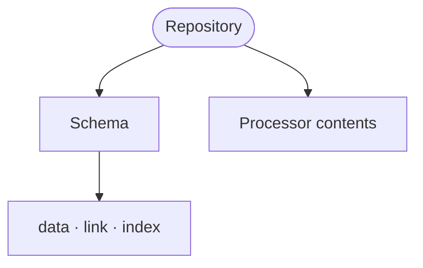

<!-- riddl-prelude
record CartItem is { id is String, sku is String }
record Cart is { id is String, items is many CartItem }
record Product is { id is String, name is String }
-->

A RIDDL repository is an abstraction for anything that can retain 
information (e.g. [messages](message.md)) for retrieval at a
later time. This might be a relational database, NoSQL database, a data lake, 
an API, or something not yet invented. There is no specific technology implied
other than the retention and retrieval of information. Thinking of repositories
only as a database is missing the mark. 

## Schemas
As part of their intrinsic definition, repositories have schemas. Schemas in 
implementation and leaves them unspecified. Repository schemas in RIDDL have
little relationship to SQL because they are not relational databases and indeed
must support the schema for any kind of data storage. The schema is specified
more like a graph database.  A set of types defines what can be placed in 
the database, an optional set of links defines how the fields of those types
are related, and a set of indices defines which fields the database indexes. 

A repository may define multiple schemas, each with its own _kind_. The kind of
schema may be: flat, relational, time-series, graphical, hierarchical, star, 
document, columnar, vector, or other. These are only suggestive of the kind of
storage layout the repository uses — but riddlc warns about a few shapes that
contradict the kind, such as a `graphical` schema with no links
(`repo-graph-no-links`) or a `flat` one with several data entries
(`repo-flat-schema-many-nodes`). The
[language reference](../references/language-reference.md#schema-clauses) lists
all eight.

<!-- riddl: in-context -->
```riddl
repository CartRepository is {
  schema CartData is relational
    of cart as record Cart
    of items as record CartItem
    link cartItems as field CartItem.id to field Product.id
    index on field Cart.id
}
```

!!! warning "A queried repository with no index at all"
    A repository that answers `on query` clauses but whose schemas declare **no
    index** draws a **CompletenessWarning** (`repo-queried-without-index`): a
    store queried without any index is a sequential scan by construction.

    It is a warning and not an Error because the model may be under-specified
    rather than self-contradictory — the author may know the table is small. It
    stays silent for a `???` stub, a repository with no schema, and a
    write-only repository that answers no queries.

    The check does **not** name which field to index, and that is a limit of
    what models say rather than caution: a repository's `on query` body is
    prose by design, so nothing in the model states which field the query
    filters on.

!!! warning "`as type T` is strict — changed in RIDDL 2.0"
    The clause says `as type`, so `T` must genuinely **be** a
    [Type](type.md). A path that lands on an Entity, or on anything else,
    is an **Error** even though it parses.

    This check previously never ran. Turning it on produced 202 errors across
    186 of the 187 models in `riddl-models` — nearly the whole corpus — every
    one of them a clause that had been relying on a check that did nothing. If
    a schema of yours suddenly errors here, that is why.

    The fix is usually to point at the `record` that describes the stored
    shape, rather than at the entity that owns it.

## Handling Messages
A repository has a [handler](handler.md) that processes 
messages with respect to the repository's stored information.

[Query messages](message.md#query) sent to the repository 
are requests for retrieval of some information. The handler should define 
how the processing of that query should proceed and yield a 
[Result message](message.md#result).

[Command messages](message.md#command) sent to the
repository are updates to the repository. The handler should define how the
update works and may optionally yield an
[Event message](message.md#event) but generally that is
handled at a higher level of abstraction. 

A repository is never changed by an **event**. An inlet that carries one is
an Error (`repo-inlet-carries-event`), and an `on event` clause draws a
Warning (`handler-repository-handles-events`). Have a
[projector](projector.md) or an entity turn the event into a command and send
that. A repository with content but no handler at all draws
`repo-no-handler`.

## Ordering and Concurrency

A repository is a [processor](processor.md), so it handles messages one at a
time — but the "one" is an **entity**, not the whole repository.

- **Queries always run concurrently.** They change nothing, so the worst a
  concurrent read can do is see slightly old data, and the cure for that is to
  ask again.
- **Writes about ONE entity are applied one at a time, in arrival order.** The
  create happens before the updates, and two updates to the same order never
  interleave.
- **Writes about DIFFERENT entities run concurrently.** There is **no total
  order** across a repository. An implementation that serializes every write
  is not being more careful; it is imposing an order the model never asked
  for, and charging every unrelated write for it.

A write names its entity by the **first field of its message typed
[`Id(entity E)`](type.md)**. If a message carries several such fields, the
first one declared decides which entity's sequence the write joins. A write
message carrying none names no entity and so has no order at all. A code
generator should say so rather than quietly pick one.

<!-- riddl: in-context -->
```riddl
entity Order is { ??? }
entity Customer is { ??? }

// Ordered with the other writes about the same `order`. `customer` is also
// an Id, but it comes second, so it does not decide the ordering.
command RecordShipment is {
  order: Id(entity Order),
  customer: Id(entity Customer),
  carrier: String
}
```

### `option available`: the CAP choice

A distributed store cannot be consistent, available and partition-tolerant all
at once — that is the CAP theorem. Partitions happen whether you plan for them
or not, so the real choice is what to give up **while one is in progress**:

| | During a partition | Write ordering |
|---|---|---|
| Default | Stays consistent — may refuse or delay a write it cannot order | Per entity, as above |
| `option available` | Keeps operating — gives up consistency | Whatever the storage engine's transactions provide |

An `available` repository asks its implementation to aim for **continuous
operation**: handle failures where they happen, and restart only when there
is truly no alternative. The [entity](entity.md) option of the same name makes
the same choice for an entity.

<!-- riddl: in-context -->
```riddl
repository Clickstream is { ??? } with {
  option is available
  briefly as "Losing order between visits beats losing the visits"
}
```

!!! note "This is a ruling for implementations"
    riddlc does not check any of this; none of it changed validation. It is
    what RIDDL's computational model requires of anything that *generates* a
    repository from a model, as clarified with the 2.6.0 release. A generator must keep per-entity ordering under the default
    and must not invent a total order across entities.

## Repositories at Domain Scope

A repository normally lives in a [Context](context.md). But a repository that
**synthesizes** messages from entities across several contexts, and is queried
by several contexts, belongs to the [Domain](domain.md) instead — putting it
inside any one context would misrepresent who owns it.

```riddl
domain Commerce is {
  repository SalesData is { ??? }   // reaches Orders, Catalog and Shipping

  context Orders   is { ??? }
  context Catalog  is { ??? }
  context Shipping is { ??? }
}
```

!!! warning "Scope validation"
    A repository's **reach** is the set of contexts owning the messages its
    `on` clauses handle.

    - **Error** (`repo-domain-scope-misplaced`) — a domain-scoped repository
      reaching only ONE context. It is
      provably unnecessary at domain scope; move it into that context. Zero
      resolvable contexts means an incomplete model rather than proof, so that
      draws nothing.
    - **CompletenessWarning** (`repo-handles-foreign-contexts`) — a
      context-scoped repository reaching another context. Consider promoting
      it to domain scope.

## Options

`transient` marks a repository whose contents are not durably persisted — a
cache-like store. `available` and `consistent` choose a side of the CAP
trade-off, as [described above](#option-available-the-cap-choice); `consistent`
is the default and need not be written. `batch` (1 argument), `microservice`
and `protocol` are also accepted.

## Occurs In
* [Context](context.md)
* [Domain](domain.md) — when it synthesizes across several contexts
* [Module](module.md)

## Contains



* `schema` — its kind, data, links and indices
* Everything a [processor](processor.md) may contain: [Type](type.md), [Constant](constant.md), [Invariant](invariant.md), [Function](function.md), [Handler](handler.md), [Streamlet](streamlet.md), nested [Processor](processor.md), [Connector](connector.md), Relationship, [Inlet](inlet.md), [Outlet](outlet.md), [Version](version.md), [Copyright](copyright.md), [Comment](comment.md)
* [Include](include.md)

