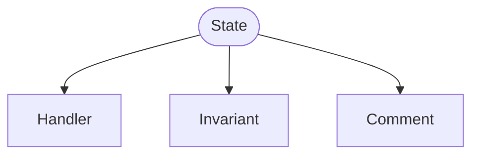

<!-- riddl-prelude
constant Zero is Whole = 0
record ActiveOrderData is { total is Natural }
record PendingData is { note is String }
record ActiveData is { note is String }
record ShippedData is { trackingNumber is String }
command CancelOrder is { orderId is String }
command ShipOrder is { trackingNumber is String }
entity Order is {
  handler OrderLifecycle is {
    on init(start: PendingData) is { morph entity Order to state Pending with start }
  }
  state Pending of record PendingData is {
    handler PendingHandler is { on command CancelOrder { ??? } }
  }
  state Shipped of record ShippedData is {
    handler ShippedHandler is { on command ShipOrder { ??? } }
  }
}
-->

A State defines a named state of an [entity](entity.md). It
references a **record** that defines the data structure
for the state, and optionally contains
[handlers](handler.md) and [invariants](invariant.md) that apply
while the entity is in that state.

!!! warning "A state is typed by a record, not by any type"
    As of RIDDL 2.0, `state X of …` takes a `record` reference specifically. A
    state is record-shaped data, so its data type must be a `record` rather
    than a plain `type` or a message. In 1.x any type reference was accepted.

An [entity](entity.md) can have multiple state definitions.
When an entity has multiple states with their own handlers,
it naturally models a
[Finite State Machine](https://en.wikipedia.org/wiki/Finite-state_machine)
—each state responds to messages differently. Use the
[finite state machine](entity.md#finite-state-machine)
[option](option.md) to make this intent explicit.

States are branches in the AST, meaning they can contain
their own definitions. The `morph` statement transitions an
entity from one state to another, changing which handlers
are active.

### Syntax

<!-- riddl: in-entity -->
```riddl
state ActiveOrder of record ActiveOrderData is {
  invariant TotalIsPositive is total > Zero

  handler ActiveOrderHandler is {
    on command CancelOrder { ??? }
    on command ShipOrder { ??? }
  }
}
```

The state body is optional — a state can also be defined simply as:

<!-- riddl: in-entity -->
```riddl
state ActiveOrder of record ActiveOrderData
```

!!! warning "Every state must have a handler somewhere"
    `State 'X' in Entity 'Y' has no handlers` is an **Error**
    (`entity-state-no-handlers`), so a state
    with no body is only valid when the *entity* declares a handler that
    covers it. Handlers may sit at either level, and an entity may carry
    both: a state-scoped handler for behavior that differs by state, and an
    entity-level handler for behavior that does not.

## Where an Entity Starts

An entity has **no initial state**. It is created without one, and its
[`on init`](onclause.md#on-init-is-creation) clause — an entity-level clause,
run once at creation — `morph`s it into the state it starts in:

<!-- riddl: in-context no-prelude=Order -->
```riddl
entity Order is {
  handler OrderLifecycle is {
    on init(start: PendingData) is { morph entity Order to state Pending with start }
    on command CancelOrder { ??? }
  }
  state Pending of record PendingData is { ??? }
  state Active  of record ActiveData  is { ??? }
  state Shipped of record ShippedData is { ??? }
}
```

Because `on init` takes the creation arguments, it can choose among states, and
which state is *declared* first decides nothing — reordering them is safe.

!!! warning "`initial state` is deprecated (since 2.8.0)"
    Through 2.7, an entity started in the state marked `initial`, or else the
    first one declared. Both still work, with that meaning, until 3.0: an
    `initial state` draws `entity-initial-state-marker`, and an entity with
    states but no `on init` that morphs draws `entity-init-no-morph`. Two
    `initial` states are an **Error** (`entity-multiple-initial-states`).

    `initial` on a **handler** is unaffected: it picks which of a state's
    handlers is live on entry. See [Handler](handler.md#the-initial-marker).

## Entry Actions

A state's [`on entry`](onclause.md#on-entry-a-states-entry-action) clause runs
each time a `morph` moves the entity *into* that state — but not at creation,
not for a `morph` into the state it is already in, and never on replay or
rehydration.

## State-Scoped Invariants

A state body may hold [invariants](invariant.md) constraining that state's
record data. This is what lets different states carry different rules — an
open account may hold any non-negative balance, while a closed one must hold
exactly nothing.

## Transitions

The `morph` statement transitions an entity from one state to another,
changing which handlers are active. Its payload is a **record** — the new
state's data — not the message that triggered the transition:

<!-- riddl: in-clauses -->
```riddl
on ship: command ShipOrder {
  morph entity Order to state Order.Shipped
    with record ShippedData(ship.trackingNumber)
}
```

## Occurs In
* [Entities](entity.md)

## Contains



* [Handler](handler.md) — how the entity behaves while in this state
* [Invariant](invariant.md) — conditions that must hold in this state
* [Comment](comment.md)

